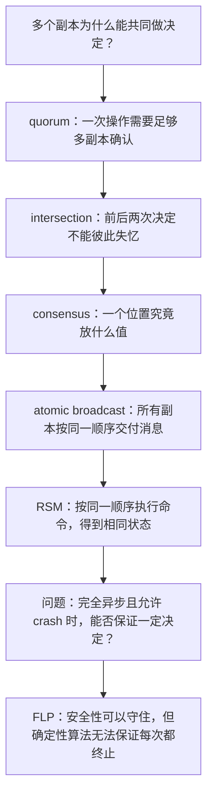
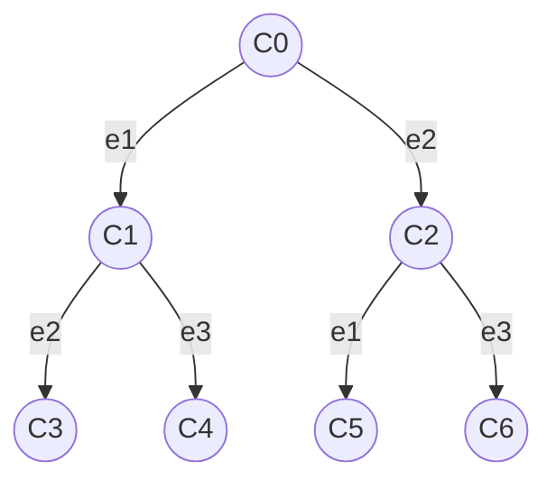
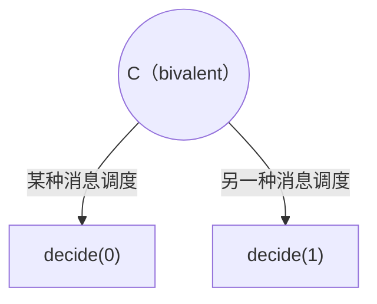
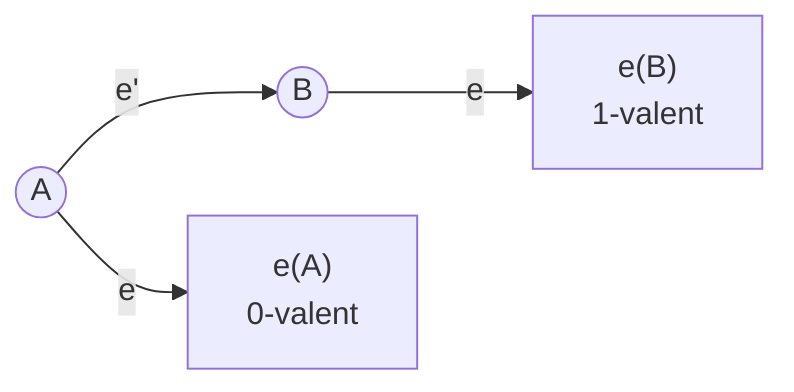
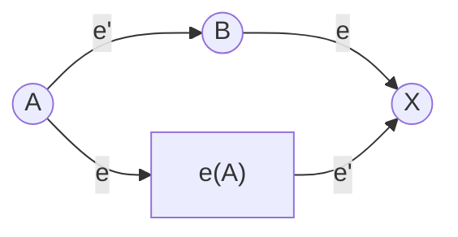
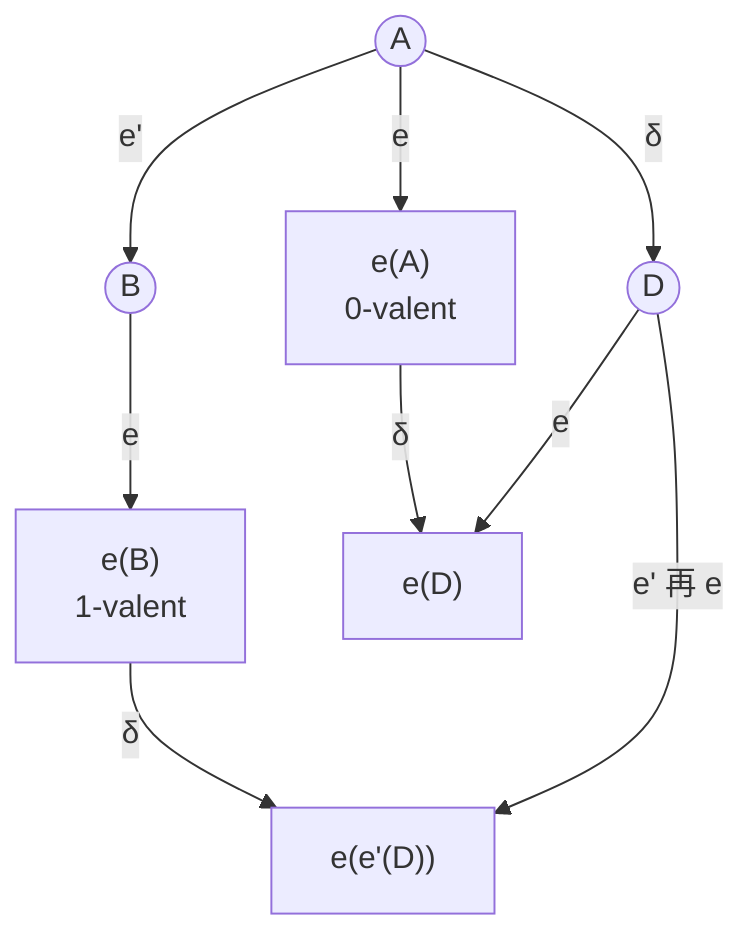



## 0. 整条理解路线



---

## 1. Quorum：重点不是“人多”，而是“前后不能失忆”

### 1.1 我最初的问题



这句话在“quorum 已经被规定为严格多数”的前提下没有错。但真正需要解释的是更前面的一层：**为什么 quorum 要设成多数？**

### 1.2 Quorum 不是固定小组

Quorum 不是系统预先指定的一组固定节点，也不是发起方随便挑的人。协议先规定合法条件，例如“5 个副本中至少得到 3 个确认”。一次操作里，谁先成功响应，谁就可能组成这次 quorum。

```text
节点：A B C D E，quorum size = 3

第一次响应集合：{A, B, C}
第二次响应集合：{A, D, E}
第三次响应集合：{C, D, E}
```

这些都可能是合法 quorum。节点也不是先寻找“和自己值相同的人”；发起者广播 proposal，各副本按协议判断能否接受，足够多节点接受同一个 proposal 后才形成支持它的 quorum。

### 1.3 为什么必须有 quorum intersection

安全性的核心要求是：任意两个能够做决定的 quorum 必须相交。

$$
Q_1 \cap Q_2 \neq \varnothing
$$

如果 $n=4$、$q=2$，就可能有：

$$
Q_1=\lbrace A,B\rbrace,\qquad Q_2=\lbrace C,D\rbrace
$$

两者完全不相交。网络分区后，左边可能支持 0，右边可能支持 1；两边都以为自己已经得到合法 quorum，Agreement 就会被破坏。

若所有 quorum 大小都是 $q$，要强制任意两个 quorum 相交，需要：

$$
2q>n \quad\Longleftrightarrow\quad q>\frac n2
$$

所以，多数派并不是为了“更民主”，而是一个集合论条件：。交集中的副本能把过去已经接受的信息带到新的操作中。当然，交集本身还不够；协议还必须规定节点如何保存、报告和服从这些信息。

### 1.4 “有 leader，不就只有一个 quorum 吗？”



有 leader 不代表只有一个 quorum。leader 负责发起 proposal、收集回复，但每次最快响应的节点可能不同。即使同一个 leader A 在任：

```text
这次：{A, B, C}
下次：{A, D, E}
```

更关键的是 leader 会故障、更换。若 $n=4,q=2$：

```text
旧 leader A：Q1 = {A, B}，接受了 0
A crash
新 leader C：Q2 = {C, D}，可能接受 1
```

新 leader 当然想询问 A、B，但 A 可能已挂，B 可能暂时不可达。如果协议仍允许 $\lbrace C,D\rbrace$ 做决定，新 quorum 就会完全绕开旧信息。因此不能只依靠“当前 leader 出现在每个集合里”，而要保证**跨任期、跨 leader 的 quorum 仍然相交**。

### 1.5 为什么 crash fault 要满足 $f<n/2$

如果系统要同时满足：

- **Safety**：任意两个 quorum 相交，因此 $2q>n$；
- **Liveness**：坏掉 $f$ 个节点后，剩余节点仍能组成 quorum，因此 $q\le n-f$；

则：

$$
\frac n2<q\le n-f
$$

从而：

$$
f<\frac n2
$$

最多可容忍：

$$
f\le \left\lfloor\frac{n-1}{2}\right\rfloor
$$

我的最终理解是：“故障超过一半就凑不到 quorum”是结果；更根本的原因是，为了让决定集合始终相交，quorum 必须超过一半。

---

## 2. 从 receive 到 RSM：消息到了，不等于已经能执行

### 2.1 `receive(m)` 和 `deliver(m)`

我一开始看到 `receive(m)`、buffer、`deliver(m)` 时，不明白为什么一条消息要经历两次“收到”。关键是分层：


- `receive(m)`：网络层已经把消息送到本机。
- `buffer`：节点本地保存已收到、但尚未被协议正式交付的消息。
- `deliver(m)`：广播协议认定消息满足条件，可以交给上层使用。
- `apply(c)`：状态机真正执行命令 $c$，修改业务状态。

因此，。

### 2.2 Reliable Broadcast 和 Atomic Broadcast



<!-- cell -->

**Reliable Broadcast（RB）**

关心一条广播消息能否可靠地被所有正确节点交付：正确节点交付了，其他正确节点最终也会交付；不重复、不伪造。

但**不要求顺序一致**：

```text
N1：deliver(A), deliver(B)
N2：deliver(B), deliver(A)
```

对 RB 来说仍然合法。

<!-- cell -->

**Atomic Broadcast（AB）**

在可靠交付之外，增加了 total order：所有正确节点必须用**同样的顺序** deliver 消息。

```text
N1：deliver(A) → deliver(B)
N2：deliver(A) → deliver(B)
N3：deliver(A) → deliver(B)
```



我原本的说法是“Consensus 决定每回合做什么，AB 负责发送消息”。更准确的修正是：**AB 的重点不是“发送”，而是“统一顺序地 deliver”。**

### 2.3 RSM 是什么，`apply(c)` 又是什么

RSM（Replicated State Machine，复制状态机）的核心公式是：

$$
\text{相同初始状态}+\text{相同命令}+\text{相同顺序}
\Longrightarrow \text{相同最终状态}
$$

例如本地状态为 `x=0`，命令 $c=$ `set(x,5)`：

```text
apply(c): x = 0 → x = 5
```

广播和共识负责让各副本认可同样的命令顺序；`apply(c)` 才是把已经排序的命令真正执行到本地状态机上。

---

## 3. Consensus、Atomic Broadcast 和 RSM 怎么接起来

### 3.1 我一直不明白的 log / slot

`log` 不必想成神秘的数据结构。先把它看成所有副本共同维护的操作列表：

```text
slot 1: withdraw(80)
slot 2: deposit(50)
slot 3: withdraw(20)
```

`slot k` 就是全局操作顺序中的第 $k$ 个位置。多个节点可能对 slot 1 提议不同命令；一次 consensus 决定这一格最终放什么。反复决定各个 slot，就形成共同的 log。

### 3.2 一个完整案例

有三个银行账户副本 `N1、N2、N3`，初始余额都是 100。客户端近乎同时发来：

```text
A = withdraw(80)
B = deposit(50)
```

| 步骤 | 层次 | 回答的问题 | 在这个例子里 |
|---|---|---|---|
| 1 | Consensus | 某个 slot 究竟选什么？ | 决定 `slot 1 = A`、`slot 2 = B` |
| 2 | Atomic Broadcast | 一系列消息按什么共同顺序 deliver？ | 所有副本都按 `A → B` deliver |
| 3 | RSM | 按这个顺序执行后，状态变成什么？ | `100 → 20 → 70` |

最后三个副本都得到 70。

在标准模型中，Consensus 与 Atomic Broadcast 可以相互归约；“每个 slot 运行一次 consensus”是理解由共识构造有序日志的一种直观方式。

---

## 4. Consensus 究竟承诺什么

常见性质包括：

1. **Agreement（一致性）**：正确节点不能决定不同的值。
2. **Validity（有效性）**：决定值必须是某个节点的输入；二值共识下，所有输入都为 $v$ 时只能决定 $v$。
3. **Termination（终止性）**：所有正确节点最终都会决定。
4. **Integrity / Uniqueness（完整性/唯一决定）**：每个节点最多决定一次，决定后不能反悔。

我把它们压缩成一句话：决定同一个、决定合法值、最终能决定、决定后不反悔。

其中 Agreement、Validity、Integrity 属于 **safety**：坏事永远不能发生。Termination 属于 **liveness**：好事最终要发生。

FLP 原论文对 Validity 的要求其实更弱，只要求“0 和 1 都有可能被决定”，排除掉“永远只输出 0”这种平凡算法就够了。下面的证明用上面这个更常见的版本，推理更直观。

现实系统的典型取舍是：。这句话正好把问题引向 FLP。

---

## 5. FLP 的直觉：一句话很简单，严格证明却不简单

### 5.1 我的第一反应：“这不是废话吗？”

在完全异步系统中，没有已知的消息延迟上界。因此一个节点长时间没回应时，我无法区分：

```text
它已经 crash
        与
它没有 crash，只是消息被延迟了很久
```



这已经给出了 FLP 的核心直觉。但严格证明的目标远强于举出一个会卡住的算法。它要证明：

> 对任意确定性 consensus 算法，只要系统完全异步并允许一个 crash-stop fault，就存在一种合法的消息调度，使算法永远无法决定。

不是“节点一挂，共识一定失败”，也不是“每次执行都会失败”，而是**算法无法保证所有合法执行都 terminate**。

### 5.2 三种场景带来的不可区分性

我曾用三个节点想象：

- 场景 A：输入全为 0，其中一个节点不响应；
- 场景 B：输入混合为 0/1，消息被长时间延迟；
- 场景 C：输入全为 1，其中一个节点不响应。

某些节点看来，B 可能和 A 完全一样；另一些节点看来，B 又可能和 C 完全一样。如果为了 Termination 过早决定，左右两边可能分别决定 0 和 1，破坏 Agreement；如果为了 Agreement 一直等待，在完全异步环境里又可能永远等不到能排除另一种可能的信息。

这个例子提供了直觉，但 FLP 还要把“对任意算法都能一直拖”形式化。

### 5.3 FLP 精确否定了什么

$$
\boxed{
\text{完全异步}+\text{允许 1 个 crash}
\Longrightarrow
\text{确定性 consensus 无法保证终止}
}
$$

，不是 Agreement 本身，也不是声称现实里永远无法达成共识。

### 5.4 为什么必须说 crash-stop

“节点故障”范围太大；证明必须说清故障模型。



<!-- tab Crash-stop -->

节点崩溃后永久停止，不恢复，也不发送欺骗性消息。FLP 的经典设定就是这个。

<!-- tab Crash-recovery -->

节点崩溃后可能重启，重启后可能带着持久化的状态重新加入。

<!-- tab Byzantine -->

节点可能任意作恶，甚至向不同节点发送互相矛盾的信息。



FLP 讨论的是异步消息传递系统中的 crash-stop 故障。即使只允许一个如此“温和”的故障，也无法得到确定性的无条件终止保证。

### 5.5 部分同步怎样绕开这个困境

现实算法通常不会要求在“永远没有延迟上界”的模型下保证活性，而采用 partial synchrony：系统前期可能任意慢，但在某个未知的全局稳定时间 GST 之后，消息延迟最终受某个有限上界 $\Delta$ 约束。

$$
t>GST\quad\Longrightarrow\quad delay\le \Delta
$$

这使超时和 leader 更换最终能够获得可靠意义。算法通常始终保护 safety，并在网络稳定后恢复 liveness。

---

## 6. FLP 的语言：configuration graph 和 valency

### 6.1 Configuration 不是普通业务 state

在区块链或状态机语境中，`state` 常指账户余额、nonce、合约存储等业务状态；FLP 的 `configuration` 是整个分布式系统的完整快照，包括：

- 每个进程的本地状态；
- 网络中尚未投递的消息（message buffer）。

因此：

```text
业务 state       = 状态机的数据状态
configuration    = 整个分布式执行的全局状态
```

### 6.2 Configuration graph



- vertex：一个 configuration；
- edge：执行一个合法 event/step；
- path：一次可能的执行；
- 整张图：所有可能消息调度形成的全部执行。

一个进程 crash 不代表当前 vertex 没有出边，只代表以后不再有该进程执行的 step；其他进程仍可继续运行。

### 6.3 为什么只看 $v\in\lbrace 0,1\rbrace$

FLP 研究 binary consensus 已经足够。如果存在一个通用 consensus 算法，我们只给它 0 和 1 作为输入，它自然也能解决 binary consensus。所以只要证明 binary consensus 不可能，general consensus 也就不可能：

$$
\text{binary consensus 不可能}
\Longrightarrow
\text{general consensus 也不可能}
$$

### 6.4 Valency 描述的是未来，不是当前输入

这是我理解 FLP 时最重要的一次修正。判断 configuration $C$ 的 valency，不是数当前有多少个 0 或 1，而是看从 $C$ 出发的**所有合法未来**：

| 类型 | 含义 |
|---|---|
| 0-valent | 所有可能执行最终都只能决定 0 |
| 1-valent | 所有可能执行最终都只能决定 1 |
| bivalent | 存在一种执行可决定 0，也存在另一种执行可决定 1 |



所以：。

一旦某个进程已经 `decide(v)`，Agreement 会使所有未来只能与 $v$ 一致，因此系统不可能再是 bivalent。

---

## 7. 引理一：一定存在初始 bivalent configuration

### 7.1 要证明什么

> 至少有一个初始 configuration 是 bivalent。

否则，每个初始 configuration 从一开始就只可能决定 0 或只可能决定 1。

### 7.2 构造一条输入序列

假设有 $n$ 个进程，构造：

$$
C_0,C_1,\ldots,C_n
$$

其中 $C_k$ 表示前 $k$ 个进程的**初始输入**为 1，其余输入为 0。这里的 0/1 是 proposal，不是已经决定的 consensus value。例如 $n=4$：

```text
C0 = (0,0,0,0)
C1 = (1,0,0,0)
C2 = (1,1,0,0)
C3 = (1,1,1,0)
C4 = (1,1,1,1)
```

根据 Validity：

$$
C_0\text{ 是 0-valent},\qquad C_n\text{ 是 1-valent}
$$

### 7.3 找到从 0 到 1 的临界位置

反设所有初始 configuration 都是 univalent，那么序列中每一项只能标成 0-valent 或 1-valent。开头是 0，结尾是 1，所以一定存在第一次变化：

$$
C_k\text{ 是 0-valent},\qquad C_{k+1}\text{ 是 1-valent}
$$

这不是说“任意输入由 0 改成 1，valency 都会变”；只是说在这条从全 0 走向全 1 的序列中，**至少存在一个临界步骤**。

### 7.4 Crash 掉唯一不同的进程

$C_k$ 和 $C_{k+1}$ 只相差某个进程 $p$ 的初始输入。让 $p$ 从一开始就 crash-stop，不执行任何 step。

算法容忍一个 crash 且保证 Termination，所以从 $C_k$ 出发，存在一条 $p$ 完全不参与的有限执行 $\sigma$，走完后其他进程已经决定了某个值 $v$。

关键在于：$\sigma$ 里没有 $p$ 的任何 step，而 $C_k$ 和 $C_{k+1}$ 除了 $p$ 的输入以外完全相同。所以 $\sigma$ 也能原样作用在 $C_{k+1}$ 上，其他进程每一步看到的东西都一样，最后也决定 $v$。

但：

- 从 $C_k$ 出发只能决定 0，所以 $v=0$；
- 从 $C_{k+1}$ 出发只能决定 1，所以 $v=1$。

矛盾。因此“所有初始 configuration 都是 univalent”的假设错误：

$$
\boxed{\text{至少存在一个初始 bivalent configuration} }
$$

---

## 8. 引理二：从 bivalent 出发，还能继续保持 bivalent

这是我卡得最久的部分。证明的难点不是“有时可以拖”，而是说明调度者总能安排步骤，使系统不被迫进入 univalent。

### 8.1 事件 $e=(m,p)$ 到底是什么

这里的 event 不是把“发送者发消息到接收者”的全过程捆成一个动作。可以把它理解成：

> 消息 $m$ 已经在网络中；现在把它 deliver 给进程 $p$，然后 $p$ 执行一个确定性的本地 step，并可能产生新的待投递消息。

$m$ 也可以是空消息 $\varnothing$，表示 $p$ 这一步什么都没收到，但仍然走了一步。所以 $(p,\varnothing)$ 永远是可以执行的。

之后要反复用到一个**交换性质**：如果两段执行 $\sigma_1$、$\sigma_2$ 涉及的进程完全不重叠，并且都能从 $C$ 执行，那么先 $\sigma_1$ 再 $\sigma_2$，和先 $\sigma_2$ 再 $\sigma_1$，会到达同一个 configuration。原因很直接：它们各改各的进程状态，各自往 buffer 里加消息，互不影响。

### 8.2 定义 $S$ 和 $S_e$

给定一个 bivalent configuration $C$，以及当前尚未投递的任意事件：

$$
e=(m,p)
$$

定义：

- $S$：从 $C$ 出发，暂时不执行 $e$ 时可到达的所有 configuration；
- $S_e=\lbrace e(E)\mid E\in S\rbrace$：对 $S$ 中每个 configuration 再执行 $e$ 所得到的结果集合。

$e$ 的消息一直在 buffer 里等着，所以 $S$ 里的每个 configuration 都能执行 $e$。其中 $e(A)$ 不是函数值，而是“从 configuration $A$ 执行事件 $e$ 后得到的新 configuration”。

要证明：

$$
\boxed{S_e\text{ 中至少存在一个 bivalent configuration} }
$$

直觉上说：即使不能永远扣住消息 $m$ 不发，也可以先执行一些别的事件，再投递 $m$，而投递后系统仍未被锁死。

### 8.3 反设 $S_e$ 全部 univalent

假设 $S_e$ 中没有 bivalent 状态。

**第一步：$S_e$ 里 0-valent 和 1-valent 都有。** $C$ 是 bivalent，所以从 $C$ 能走到某个决定 0 的 configuration $E_0$。如果走到 $E_0$ 的路上没执行过 $e$，那 $E_0\in S$，$e(E_0)\in S_e$，并且它只能是 0-valent；如果路上执行过 $e$，那执行 $e$ 的那一刻得到的 configuration 就在 $S_e$ 里，而且它能走到 $E_0$，也只能是 0-valent。1 同理。

**第二步：找到相邻的一对。** 从 $C$ 出发、不执行 $e$，沿一条路径往下走，每一步都看“这时候执行 $e$ 会得到什么颜色”。起点和终点颜色不同，所以一定存在一个第一次变色的相邻边：

$$
A\xrightarrow{e'}B
$$

并且：

$$
e(A)\text{ 是 0-valent},\qquad e(B)\text{ 是 1-valent}
$$

（反过来 0/1 对调也一样，证明对称。）注意：$A$、$B$ 都还没有执行 $e$；$B$ 只比 $A$ 多执行一个事件 $e'=(m',p')$。图像是：





答案是：**并不保证，所以必须分两种情况**，看 $e'$ 是否也作用于进程 $p$。

### 8.4 情况一：$e'$ 不作用于 $p$——直接交换

若 $p'\ne p$，那么 $e$ 与 $e'$ 可交换：



即：

$$
A\xrightarrow{e'}B\xrightarrow e X
$$

和：

$$
A\xrightarrow e e(A)\xrightarrow{e'}X
$$

到达同一个 $X$。

但从 0-valent 的 $e(A)$ 出发，任何可达状态都只能决定 0，所以 $X$ 必须是 0-valent；另一方面，$X=e(B)$ 已知是 1-valent。矛盾。

### 8.5 情况二：$e'$ 也作用于 $p$——引入不经过 $p$ 的 $\delta$

如果 $p'=p$，$e'$ 和 $e$ 都修改 $p$ 的本地状态，不能直接交换。这正是 $\delta$ 出现的原因。

从 $A$ 开始，假设 $p$ 此刻 crash-stop，此后完全不让它执行。算法声称能容忍一个 crash 并满足 Termination，那么其他进程仍必须最终决定。因此存在一条有限执行路径：

$$
A\xrightarrow{\delta}D
$$

其中 $\delta$ 完全不包含 $p$ 的 step，且 $D$ 里已经有进程做出了决定。



我一开始是按 $\delta$ 决定 0 还是决定 1 分情况讨论的，写得很绕。后来发现原论文有更直接的办法：不用管 $\delta$ 决定了什么，直接证明 $D$ 是 bivalent。

$\delta$ 不涉及 $p$，而 $e$、$e'$ 都只涉及 $p$，所以 $\delta$ 可以和它们交换：



- 左边：$\delta(e(A)) = e(\delta(A)) = e(D)$。它是从 0-valent 的 $e(A)$ 走过来的，所以只能决定 0。
- 右边：$\delta(e(B)) = \delta(e(e'(A))) = e(e'(\delta(A))) = e(e'(D))$。它是从 1-valent 的 $e(B)$ 走过来的，所以只能决定 1。

于是从 $D$ 出发，既能走到只决定 0 的地方，也能走到只决定 1 的地方，$D$ 是 bivalent。但 $D$ 里已经有进程做出了决定，决定不能反悔，$D$ 必须是 univalent。矛盾。

两种情况都推翻了“$S_e$ 全部 univalent”的假设，所以：

$$
\boxed{S_e\text{ 中必然存在 bivalent configuration} }
$$

---

## 9. 两个引理怎样拼成 FLP

现在主线非常短：

1. 引理一给出一个初始 bivalent configuration $C_0$。
2. 引理二说明：从任意 bivalent 出发，对任意一个待处理事件 $e$，都能先执行一段别的事件、最后执行 $e$，仍然停在 bivalent。
3. 把所有进程排成一个队列，轮流处理：每一轮取队首进程 $p$，令 $e$ 为 buffer 里发给 $p$ 的最早那条消息（没有就用空消息 $(p,\varnothing)$），用引理二执行 $e$ 并保持 bivalent，然后把 $p$ 挪到队尾。

$$
C_0\to C_1\to C_2\to C_3\to\cdots
$$

4. 这样构造出的无限执行里，每个进程都无限次地走步，每条发出的消息最终都会被收到。一旦发生决定，系统就会进入 univalent；而这条执行始终 bivalent，所以永远不会决定。

因此，对任意满足假设的确定性 consensus 算法，都存在一条合法但不终止的执行。这足以否定“所有合法执行都保证 Termination”。



---

## 10. 最短复述


